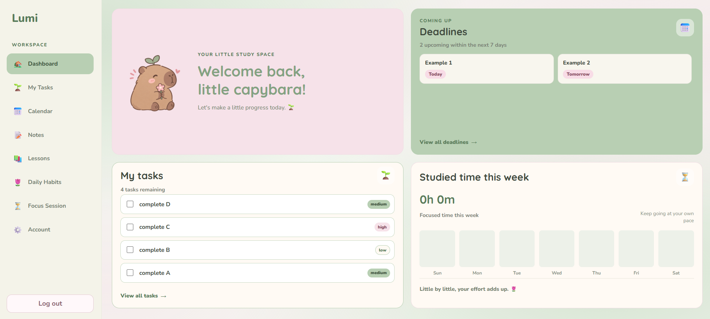
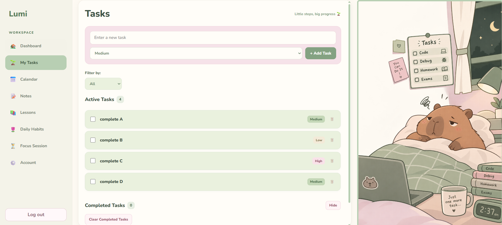
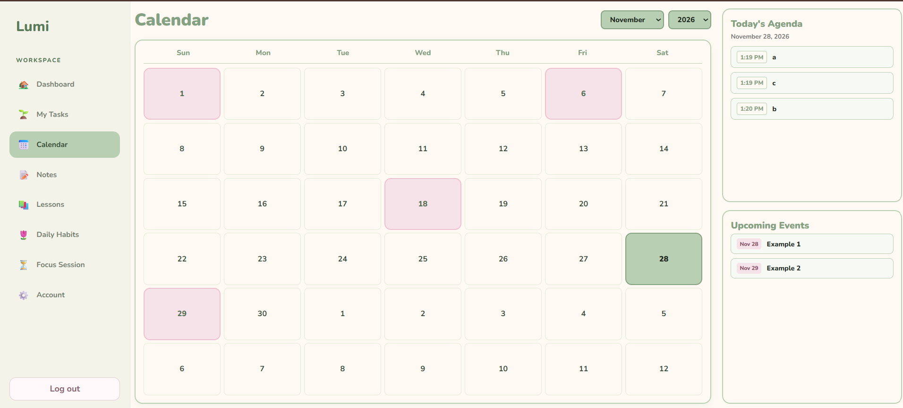
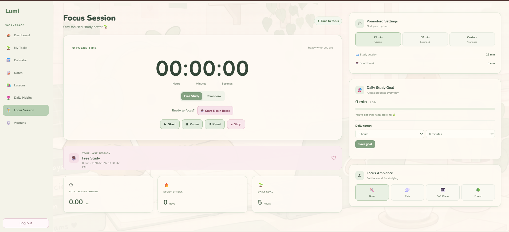
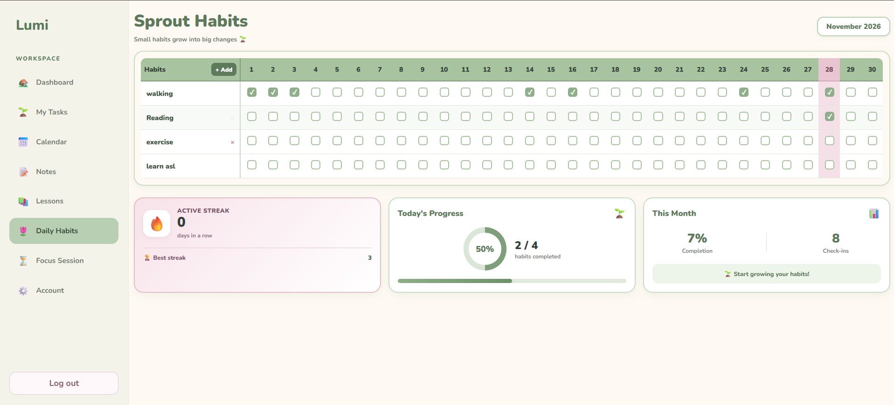
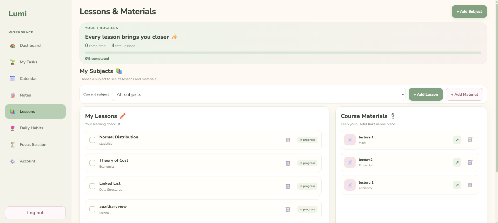
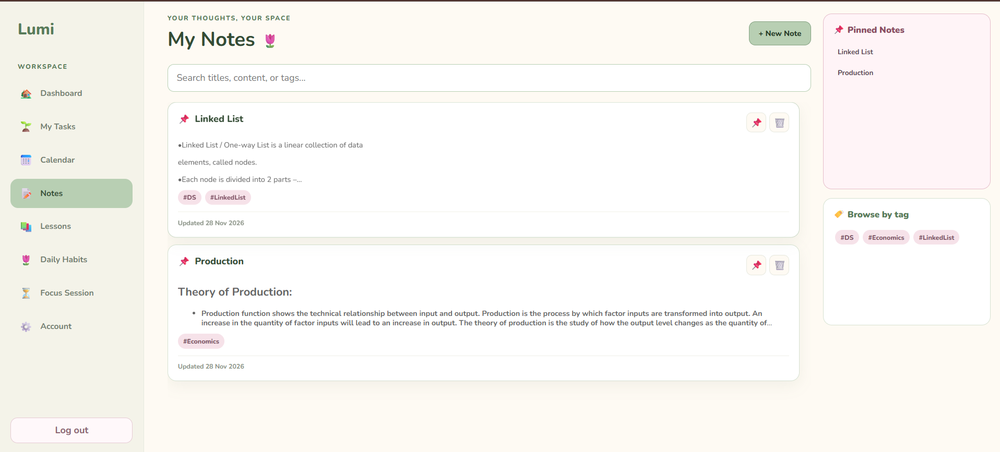

# Lumi — Study Planner & Productivity App

**Lumi** is a web-based productivity application designed to help students manage academic tasks, organize schedules, build consistent habits, and track study sessions.

It brings essential study-planning tools together in one place through a clean, responsive interface.

**[Visit Lumi →](https://lumi-56bs.onrender.com)**
---

## Overview

Managing academic responsibilities often requires switching between different tools for tasks, schedules, notes, and study tracking. Lumi aims to simplify this process by providing these tools within a single application.

Users can organize academic activities, monitor their progress, and maintain their study routines from one dashboard.

## Features

| Feature | Description |
|---|---|
| **Dashboard** | View upcoming deadlines, active tasks, and weekly study progress. |
| **Task Management** | Create, edit, complete, and delete tasks with priority levels. |
| **Calendar** | Schedule and organize activities by date and time. |
| **Notes** | Create, edit, and manage personal study notes. |
| **Daily Habits** | Track daily habits and maintain consistent routines. |
| **Focus Sessions** | Use preset or customizable timers for focused study sessions. |
| **User Authentication** | Register, log in, and securely access a personal account. |
| **Account Management** | Manage account settings and delete an account. |

## Technology Stack

**Frontend**
- HTML5
- CSS3
- JavaScript
- EJS

**Backend**
- Node.js
- Express.js

**Database**
- MongoDB
- Mongoose

**Authentication & Security**
- JSON Web Tokens (JWT)
- bcrypt
- express-validator

**Deployment**
- Render
- MongoDB Atlas

## Application Preview

### Dashboard


### Task Management


### Calendar


### Focus Sessions


### Daily Habits


### Lessons


### Notes


## Try Lumi

Lumi is available online. No installation is required.

1. Visit [Lumi](https://lumi-56bs.onrender.com).
2. Create an account.
3. Start organizing your study routine.

## Run Locally

You can run Lumi locally for learning, exploration, and personal evaluation.

### Prerequisites

- [Node.js](https://nodejs.org/)
- npm
- [MongoDB](https://www.mongodb.com/) (local installation or MongoDB Atlas account)
- Git

### Installation

1. Clone the repository:

   ```bash
   git clone https://github.com/tasmia-tanha/Lumi.git
   ```

2. Navigate to the project directory:

   ```bash
   cd Lumi
   ```

3. Install dependencies:

   ```bash
   npm install
   ```

4. Create a `.env` file in the root directory and configure the required environment variables:

   ```env
   APP_NAME=Lumi
   PORT=5000
   MONGO_CONNECTION_STRING=mongodb://localhost/lumi
   COOKIE_NAME=your_cookie_name
   COOKIE_SECRET=your_cookie_secret
   JWT_SECRET=your_jwt_secret
   JWT_EXPIRES=your_jwt_expiration
   ```

   Replace the placeholder values with your own configuration. You can use a MongoDB Atlas connection string instead of a local MongoDB URI.

5. Start the development server:

   ```bash
   npm run dev
   ```

6. Open the application in your browser:

   ```text
   http://localhost:5000
   ```

**Note:** Running a local instance requires your own database and environment configuration. The hosted application's database credentials and secrets are not included in this repository.

## Privacy & Security

Lumi uses password hashing and authentication to protect user accounts. Application data is associated with individual user accounts.

For further information, refer to the [Privacy Policy](https://lumi-56bs.onrender.com/privacy) and [Terms of Service](https://lumi-56bs.onrender.com/terms).

## Author

**Sk. Tasmia Akter Tanha**  
Computer Science & Engineering Student  
Chittagong University of Engineering & Technology (CUET), Bangladesh

[GitHub Profile](https://github.com/tasmia-tanha)

## Usage & Copyright

Copyright © 2026 Tasmia Tanha. All rights reserved.

This project is publicly available for viewing, learning, and personal evaluation purposes. You are welcome to explore the source code and run the application locally.

However, you may not:

- Claim this project or its source code as your own work.
- Reproduce, redistribute, or republish the project or substantial portions of its code.
- Use this project or its components for commercial purposes or personal gain.
- Modify and present this project as your own original work.

Please respect the time, effort, and original work behind this project. For any other use, prior written permission from the author is required.

---

**Lumi** — A more organized approach to studying.